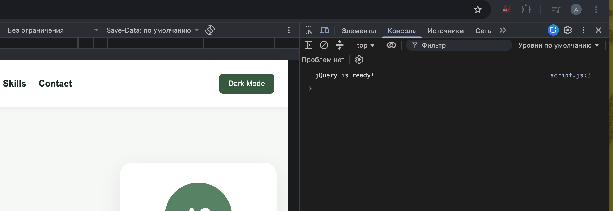
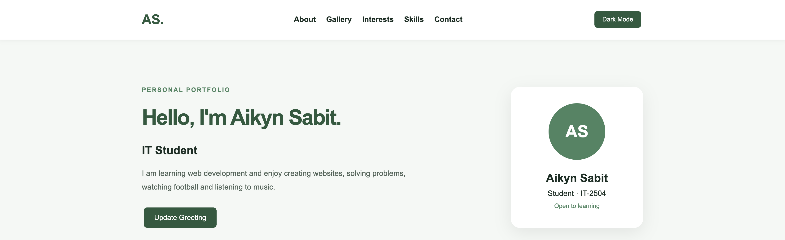
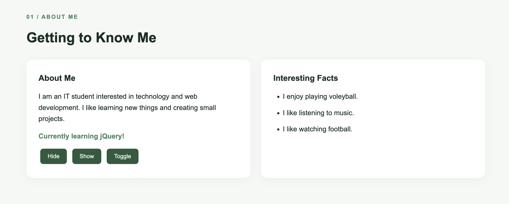
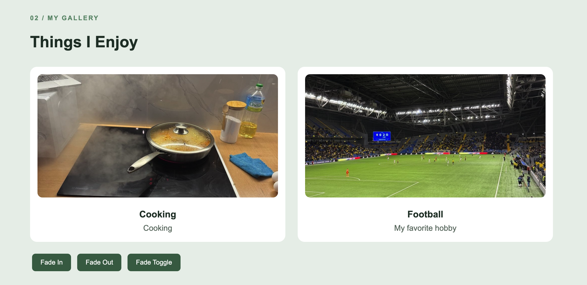
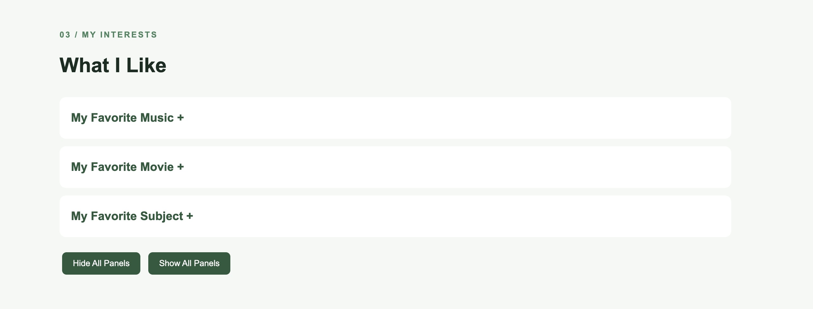
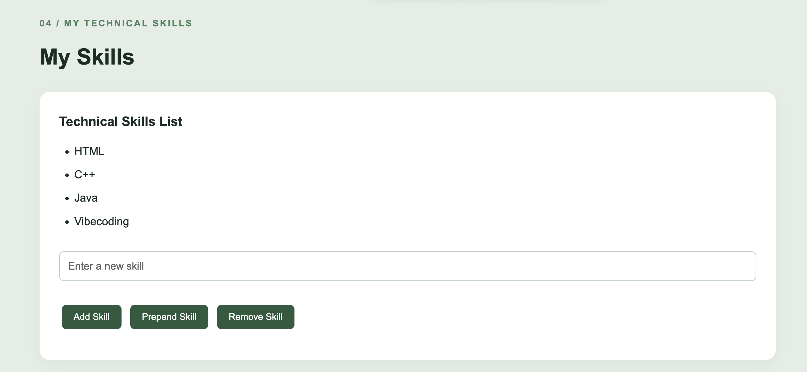
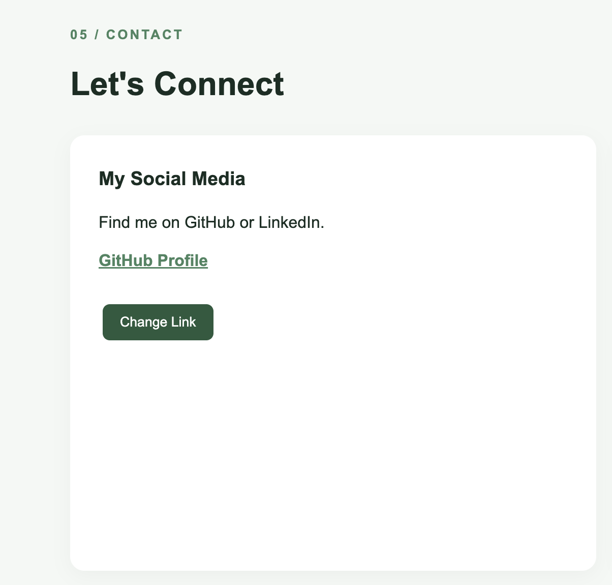
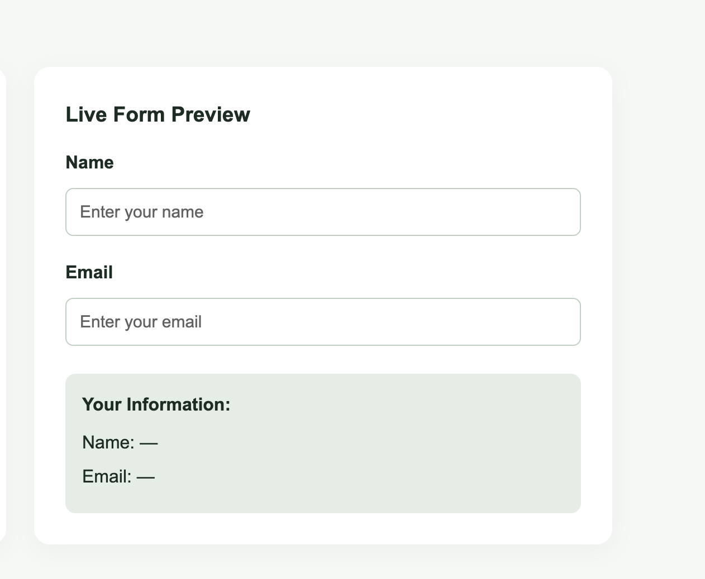
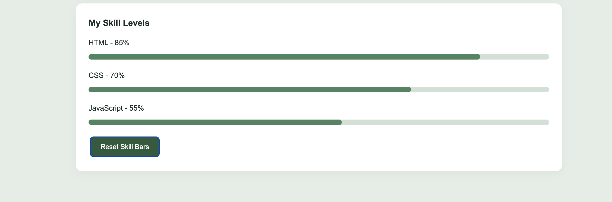

# Assignment #6 — jQuery (Selectors, Effects, Animations)

**Name:** Aikyn Sabit  
**Group:** IT-2504

## Task 0 — Getting Started with jQuery

Included the jQuery library using CDN. Used `$(document).ready()` to check when the page is loaded. Printed "jQuery is ready!" in the browser console.

## Task 1 — Selectors & CSS

Created a personal portfolio with my name, headline and introduction. Used tag, ID and class selectors. Updated text dynamically using `.text()` and `.html()`. Added light and dark theme buttons using `.css()` and jQuery.

## Task 2 — Visibility Methods

Created an About Me section with a short biography, current status and fun facts. Added Hide, Show and Toggle buttons using `.hide()`, `.show()` and `.toggle()`.

## Task 3 — Fade Methods

Created a gallery with two images about technology and football. Added Fade In, Fade Out and Fade Toggle buttons using `.fadeIn()`, `.fadeOut()` and `.fadeToggle()`.

## Task 4 — Slide Methods

Created three collapsible sections about my favorite music, movie and subject. Used `.slideUp()`, `.slideDown()` and `.slideToggle()` to control the panels.

## Task 5 — Add & Remove Elements

Created a technical skills list with HTML, CSS, JavaScript and jQuery. Added an input field and three buttons: Add Skill, Prepend Skill and Remove Skill. Used `.append()`, `.prepend()` and `.remove()`. Prevented empty skills from being added.

## Task 6 — Modifying Attributes

Added a GitHub profile link and a Change Link button. Used `.attr()` to change the link destination between GitHub and LinkedIn.

## Task 7 — Form Interaction

Created a form with Name and Email inputs. Used `.val()` and `.text()` to display the entered information live below the form.

## Task 8 — Basic Animation

Created three skill bars for HTML, CSS and JavaScript. Used `.animate()` to increase their width and animate them back to zero when the button is clicked again.

## Summary

During this assignment, I learned how to use jQuery for selecting elements, changing styles, handling events and creating animations. I also practiced working with forms, modifying HTML elements and using different visual effects.

## Link to Website

(https://aikynsabit077.github.io/WEB6/)
